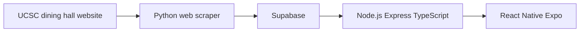

# MacroSlug

UCSC Dining Hall Nutrition & Macro Tracker

Menu data is collected from the UCSC dining hall website, stored in Supabase, and served to the mobile app through the API.



The scraper reads the public dining hall pages and writes menu and nutrition data into Supabase. The Express API in `apps/api` reads that data and exposes it over HTTP. The Expo app is the client that calls the API.

## Prerequisites

- Node.js and npm
- Python 3, for the scraper in `apps/scraper`
- [Docker Desktop](https://www.docker.com/products/docker-desktop/), for the local Supabase database used in development and tests

Install the root dependencies once. This installs the Supabase CLI that the `npx supabase` commands below use, so everyone runs the same version:

```bash
npm install
```

## Local database

The local database is a full Supabase stack running in Docker on your own machine. It has the same tables as the hosted project, plus a few fake foods from `supabase/seed.sql`. Use it for development and tests so nothing touches the real data.

Start Docker Desktop, then from the repository root:

```bash
npx supabase start
```

The first run downloads the Docker images and takes a few minutes. When it finishes, it prints the local URLs and keys. Print them again at any time with `npx supabase status`.

- **Studio**, the local dashboard: `http://127.0.0.1:54323`
- **Project URL**, which the code connects to: `http://127.0.0.1:54321`
- **Secret key**, the local service role key

Reset the database to the migrations plus seed data:

```bash
npx supabase db reset
```

Stop it when you are done:

```bash
npx supabase stop
```

The local services are reachable from other devices on the same network, and Studio has no password. Stop the stack when you are not using it, especially on shared Wi-Fi.

## Environment files

Each app loads a `.env` file from its own folder. None of these files are committed; `.gitignore` excludes `.env` and `.env.*`.

| File | Database it points at | Used by |
| --- | --- | --- |
| `apps/api/.env.test` | Local database | API tests |
| `apps/api/.env` | Hosted Supabase project | API |
| `apps/scraper/.env` | Hosted Supabase project | `ingest_food.py` |

Every file has the same two variables:

```
SUPABASE_URL=
SUPABASE_SERVICE_ROLE_KEY=
```

### `apps/api/.env.test`

Fill it from the output of `npx supabase start` or `npx supabase status`:

```
SUPABASE_URL=http://127.0.0.1:54321
SUPABASE_SERVICE_ROLE_KEY=<Secret key from npx supabase status>
```

Tests must only ever use local values. Never put the hosted URL or key in this file.

### `apps/api/.env` and `apps/scraper/.env`

Fill these from the hosted project's dashboard on supabase.com:

- `SUPABASE_URL`: the project URL, `https://<project-ref>.supabase.co`, under **Connect → Server** or **Project Settings → Data API**.
- `SUPABASE_SERVICE_ROLE_KEY`: the secret key (`sb_secret_...`), under **Project Settings → API Keys**. Do not use the publishable key; it cannot read or write the tables.

The hosted secret key has full access to the production database. Get it from the dashboard yourself instead of passing it around in chat, and never commit it. To try the scraper's ingest without touching real data, point `apps/scraper/.env` at the local URL and secret key instead.

## Database schema changes

Schema changes go in migration files under `supabase/migrations`. See [`supabase/README.md`](supabase/README.md) for creating migrations and applying them to the hosted project.

## Run the backend API

From the repository root:

```bash
cd apps/api
npm install
npm run dev
```

`npm run dev` starts the API with `tsx watch src/index.ts` and restarts it when files change. The server listens on port 3000, or on the port in the `PORT` environment variable. A healthy process responds to `GET http://localhost:3000/api/health` with `{ "status": "ok" }`.

## Run the mobile app

Install dependencies once, then start Expo from the repository root:

```bash
cd apps/mobile
npm install
cd ../..
npm run dev:mobile
```

Or start it from the app directory:

```bash
cd apps/mobile
npm install
npm start
```

Both commands run `expo start`. The terminal prints a QR code. Install Expo Go on your phone, then scan that code. The phone and the computer need to be on the same network.
