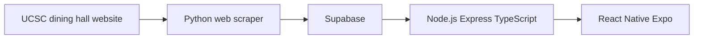

# MacroSlug

UCSC Dining Hall Nutrition & Macro Tracker

Menu data is collected from the UCSC dining hall website, stored in Supabase, and served to the mobile app through the API.



The scraper reads the public dining hall pages and writes menu and nutrition data into Supabase. The Express API in `apps/api` reads that data and exposes it over HTTP. The Expo app is the client that calls the API.

## Run the backend API

From the repository root:

```bash
cd apps/api
npm install
npm run dev
```

`npm run dev` starts the API with `tsx watch src/index.ts` and restarts it when files change. The server listens on port 3000, or on the port in the `PORT` environment variable. A healthy process responds to `GET http://localhost:3000/api/health` with `{ "status": "ok" }`.

## Run the mobile app

Install dependencies once, then start Expo from the repository root:

```bash
cd apps/mobile
npm install
cd ../..
npm run dev:mobile
```

Or start it from the app directory:

```bash
cd apps/mobile
npm install
npm start
```

Both commands run `expo start`. The terminal prints a QR code. Install Expo Go on your phone, then scan that code. The phone and the computer need to be on the same network.
